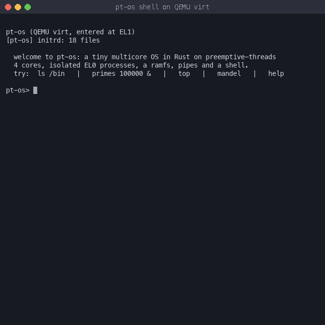

# preemptive-threads / pt-os

**A multicore OS kernel in Rust that runs isolated user programs (EL0,
per-process address spaces) on QEMU and the Raspberry Pi, built on the
preemptive-threads core.**



*A real session, recorded from pt-os's serial port on QEMU `virt` (4x
Cortex-A53). It shows `ls /bin`, a background `primes` job and `wait`, a
pipeline, `top` with a background `spin` holding one core, `mandel` on four
worker processes, `crash` being killed while the shell carries on, and
Ctrl-C on `spin`. The keystrokes went through the PL011 receive interrupt
and the kernel's line discipline. The output and timing are as recorded
(`scripts/shell-session.py --record`, rendered by `scripts/cast2gif.py`),
with pauses over 2.5 s shortened.*

pt-os boots on all four cores with nothing underneath, unpacks an initrd
into a RAM file system and starts a shell. Every program runs at EL0 in
its own address space and talks to the kernel through `svc #0`. A
program that faults is killed alone, with a one-line report, and
everything else keeps running. Underneath is `preemptive-threads`, a
`no_std` crate that owns everything from the first instruction:
exception-level drop, MMU, vectors, interrupt controllers, secondary-core
bring-up, heap, a preemptive SMP scheduler and its synchronisation
primitives. The crate can also be used on its own as a threading library
(see [Using the core crate](#using-the-core-crate)).

## Quick start

Requirements: Rust 1.88 or newer with the `aarch64-unknown-none` target and
`llvm-tools`, plus QEMU 8 or newer.

```bash
rustup target add aarch64-unknown-none
rustup component add llvm-tools
brew install qemu            # or: sudo apt install qemu-system-arm

make run-os-virt             # pt-os on QEMU virt, 4 cores; Ctrl-A X quits QEMU
```

`make run-os-virt` builds the user programs, packs them into the initrd,
builds the kernel and drops you at the prompt:

```text
pt-os> ls /bin
pt-os> primes 50000000 &
[pid 3] started on cpu0
pt-os> wait
pt-os> cat /etc/motd | grep pt-os | wc
pt-os> top                   # per-core load; any key quits
pt-os> mandel
pt-os> crash                 # killed, with one line: [pid N] segfault (write) at 0x0 (pc ...)
pt-os> echo still alive && spin 60000      # then Ctrl-C
pt-os> help
```

`make run-os-raspi3b` does the same on QEMU's Raspberry Pi 3 machine.

## Features

| Area | What |
|------|------|
| User processes | EL0 programs in per-process address spaces: private page tables, 8-bit ASIDs (no TLB flush on a switch), the kernel mapped EL1-only and never executable from EL0. A static ELF64 loader with W^X, `sbrk` heaps, guarded stacks, argv. |
| Isolation and faults | User pointers are never dereferenced: `copy_from_user`/`copy_to_user` check the process's VMAs (no PAN on the Cortex-A53). A data abort, bad jump or undefined instruction kills only that process, with one line such as `[pid 14] segfault (write) at 0x0 (pc 0x4000100160)`. Every frame, page table and ASID goes back on exit. |
| System calls | 26 calls through `svc #0`. Processes: `spawn` with fd mappings and process groups, `wait`, `kill`, `procinfo`, `sysinfo`. Files: `open`, `read`, `write`, `readdir`, `stat`, `mkdir`, `unlink`, `chdir`. Also `pipe`, `dup2`, `sleep`, `sbrk`, `setfg` and console `ioctl`s. |
| File system | A writable ramfs unpacked from a cpio initrd generated at build time, per-process fd tables with POSIX sharing semantics, 4 KiB pipes with EOF and `EPIPE`, `/dev/console` and `/dev/null`. |
| Console | The PL011 receive interrupt on both boards, feeding a line discipline: echo, backspace, Ctrl-U, Ctrl-D, raw mode. Ctrl-C kills the foreground process group. |
| Userland | `ulib` (`_start`, syscall wrappers, `println!`, a heap over `sbrk`, files) and 17 programs. `sh` has pipelines, `<` `>` `>>`, `&` jobs, `;` and `&&`, `jobs`, `wait`, `kill`, `cd`, and Ctrl-C for the foreground job or a `wait`. Also `ls`, `cat`, `echo`, `wc`, `grep`, `ps`, `top`, `primes`, `mandel`, `stress`, `crash`, `spin`, `sleep`, `rm`, `mkdir`. |
| Scheduler (core crate) | Preemption on all four cores (1 kHz tick), per-core run queues with four priority bands, round-robin or FIFO, work stealing, reschedule IPIs, CPU affinity. One context-switch path for yield, block, exit and IRQ preemption, with full FP/SIMD state. |
| Synchronisation (core crate) | `Mutex` with priority inheritance and hand-off, `Semaphore`, `Condvar`, bounded MPMC `channel`, wait queues (also interruptible ones), `sleep` on a deadline queue, `JoinHandle::join` returning the thread's value. |
| Hardware bring-up (core crate) | EL3/EL2 to EL1 drop, identity-mapped MMU with caches on every core, GICv2 or the BCM2836 ARM-local controller, PSCI or spin-table secondary start, PL011 at 115200 baud, crash dumps with decoded ESR. |

## Status and tests

`make test` runs every row below on all three QEMU machines, and GitHub
Actions runs it on every push.

| Machine | thread tests (`make test-threads`) | OS tests (`make test-os`) | shell session (`make test-shell`) |
|---------|------------------|--------------|----------------|
| QEMU `virt`, entered at EL1 (PSCI over HVC) | 16/16 | 21/21 | 17/17 checks |
| QEMU `virt,virtualization=on`, entered at EL2 (EL2 to EL1 drop, PSCI over SMC) | 16/16 | 21/21 | 17/17 checks |
| QEMU `raspi3b`, flat image released through the spin-table stub at EL2, like the Pi firmware | 16/16 | 21/21 | 17/17 checks |
| Real Raspberry Pi Zero 2 W | verified on QEMU raspi3b; real Pi Zero 2 W pending | | |

- **Thread tests** (`examples/test_kernel.rs`) check SMP boot,
  preemption, join values, mutexes under contention, channels, sleep
  accuracy, priority inheritance and bands, FIFO, semaphores, condvars, FP
  state across preemption, and that threads are reaped without leaks.
- **OS tests** (`os/examples/os_test.rs`) check exit codes; writes to
  kernel memory, executing kernel code and undefined instructions killing
  only the process; isolation between processes; `sbrk`; preemption of a
  syscall-free loop; 32 processes over 4 cores; rejected ELF images; ASID
  exhaustion. They also cover the file system, fd inheritance, pipe EOF and
  `EPIPE`, `EINTR`, the line discipline, Ctrl-C and a whole shell session,
  and check that frames and ASIDs come back to their baseline.
- **Shell session** (`scripts/shell-session.py`) boots the real pt-os
  image and types into its serial port one character at a time. It
  covers pipes, `ls`, a background job and `wait`, redirects, a 3-stage
  pipeline, `crash` (exactly one fault line), `;` and `&&`, `mandel`,
  Ctrl-C on a running job and Ctrl-C during `wait`.

The test kernels exit QEMU through semihosting, so the exit status is the
verdict. A watchdog in `scripts/qemu-run.sh` kills hangs, and a watchdog
thread in each test kernel dumps the scheduler state if a test stalls.

```bash
make test             # all of the above on virt, virt-el2 and raspi3b
make test-os-virt     # one suite on one machine
make clippy doc       # what CI checks besides the tests
```

## Layout

```text
src/            preemptive-threads, the core crate (no_std library)
  arch/         boot.rs (EL drop, MMU, SMP entry), vectors.rs (EL1 and EL0 traps),
                user.rs (run_user, fault decoding), context.rs, mmu.rs (tables, ASIDs), timer.rs
  platform/     rpi.rs + bcm2836.rs (Pi), virt.rs + gic.rs + psci.rs (QEMU virt), pl011.rs
  sched/        scheduler, per-core state, run queues, sleep queue
  sync/         spinlocks, wait queues, Mutex, Semaphore, Condvar, channel
  mem/          heap, stack pool, frame allocator
examples/       test_kernel.rs (thread tests), rpi_kernel.rs (threading demo)
os/             pt-os, the kernel binary
  src/          process.rs, syscall.rs, mm.rs (VMAs, user copies), elf.rs, vfs.rs,
                initrd.rs, console.rs, main.rs (boot: initrd, console, sh)
  examples/     os_test.rs (OS tests)
  build.rs      packs user/bin and user/rootfs into the cpio initrd
user/           programs that run at EL0
  ulib/         user library
  bin/          the userland: sh, ls, cat, top, mandel, ...
  tests/        programs used by the OS tests
  rootfs/       /etc/motd and /tmp
scripts/        qemu-run.sh, shell-session.py, cast2gif.py
docs/           ARCHITECTURE.md, demo.gif
```

[docs/ARCHITECTURE.md](docs/ARCHITECTURE.md) explains the boot path, the
context layout, interrupts, the scheduler, address spaces, EL0 and EL1
transitions, the path of a system call, the file system, the console and
the process lifecycle.

## Using the core crate

`preemptive-threads` works without pt-os, as a threading library for
bare-metal AArch64. An application provides one function and gets threads
that are preempted by the timer and spread across all four cores:

```rust
#![no_std]
#![no_main]
extern crate alloc;
use alloc::vec::Vec;
use preemptive_threads::{self as pt, println, sync::Mutex, thread, Config};

static TOTAL: Mutex<u64> = Mutex::new(0);

#[no_mangle]
fn kernel_main() -> ! {
    pt::start(Config::default(), main)
}

fn main() {
    let workers: Vec<_> = (0..8u64)
        .map(|i| thread::spawn(move || { *TOTAL.lock() += i; i * i }))
        .collect();
    let squares: u64 = workers.into_iter().map(|h| h.join()).sum();
    println!("sum of squares {} total {}", squares, *TOTAL.lock());
}
```

`Config` sets the policy (`RoundRobin` or `Fifo`), tick rate, time slice
and core count. `thread::Builder` sets a thread's name, priority (0-255),
stack size and CPU affinity. Cargo features:

| feature | effect |
|---------|--------|
| (none) | BCM2837 boards: Pi Zero 2 W, Pi 3, QEMU `raspi3b` |
| `qemu-virt` | QEMU `virt` (GICv2, PSCI, UART at 0x0900_0000) |
| `semihosting` | lets `arch::semihosting::exit` stop QEMU; only for emulator builds |

The crate's build script links its examples with `rpi0w2.ld` (or
`qemu_virt.ld`). A kernel in another crate needs `-C link-arg=-T<script>`
with one of those scripts, as `os/build.rs` does. `make run-raspi3b` runs
the threading demo (`examples/rpi_kernel.rs`).

## Running on a real Pi Zero 2 W

Not yet verified on the board itself. Everything below works the same on
QEMU `raspi3b`, which boots the image the way the firmware does.

You need a Pi Zero 2 W, a micro-SD card and a 3.3 V USB-to-serial adapter
(the shell lives on the serial port).

1. Build the SD card kit: `make sdkit`. `build/sdkit/` then holds every
   image built without semihosting (which would trap on real hardware) and
   checked for instructions the BCM2837 lacks: `uart0.img` (a serial and
   ACT LED check with no OS), `test8.img` (thread tests), `ostest8.img`
   (OS tests), `ptos8.img` (the shell) and `kernel8.img` (the demo); the
   firmware (`bootcode.bin`, `start.elf`, `fixup.dat`, the Zero 2 W device
   tree and `overlays/disable-bt.dtbo`, all from one pinned
   [raspberrypi/firmware](https://github.com/raspberrypi/firmware) release),
   `config.txt`, `README.txt` (step-by-step boot and troubleshooting) and
   `SHA256SUMS`. `make sdkit-sync SDCARD=<dir>` copies it into a folder.
2. Format the SD card as FAT32 and copy everything in `build/sdkit/` to its
   root, the `overlays` folder included.
3. Pick the kernel in `config.txt` (one `kernel=` line). The kit's file:

   ```ini
   arm_64bit=1
   kernel=uart0.img
   kernel_address=0x80000
   enable_uart=1
   init_uart_clock=48000000
   dtoverlay=disable-bt
   ```

   The firmware then starts the kernel at EL2 at 0x80000 (where the linker
   script puts it) and parks cores 1-3 on the spin table, as `make
   test-raspi3b` emulates. Boot `uart0.img` first, then `test8.img`,
   `ostest8.img` and `ptos8.img`.
4. Wire the adapter: adapter RX to GPIO14 (pin 8), adapter TX to GPIO15
   (pin 10), GND to GND (pin 6). Do not connect its 5 V or 3.3 V pin.
5. Open the console at 115200 8N1 (`screen /dev/tty.usbserial-* 115200` on
   macOS, `screen /dev/ttyUSB0 115200` on Linux) and power the Pi. Each
   kernel starts with a few `[boot]` lines (exception level, MIDR, counter
   frequency, SCTLR, the RAM range the firmware reports, board and
   firmware revision, `cpuN online`); with `ptos8.img` the banner says
   `entered at EL2`, followed by the motd and the `pt-os>` prompt.

If nothing happens: check that RX and TX are not swapped, that the card is
FAT32 with the files at its root, and that `arm_64bit=1` is set. Garbage on
the serial line means the UART clock is not 48 MHz (keep
`init_uart_clock=48000000`). Fewer than 4 cores means the firmware did not
use the spin table (there must be no `armstub=` line).

## Limitations

- Processes are single-threaded and created with `spawn` (no `fork`).
  Programs are static ELF64 binaries. There are no signals beyond kill and
  Ctrl-C, and no `mmap`.
- The file system lives in RAM and is lost on reboot. There is no SD
  card, USB, network or GPU driver.
- At most 255 live processes (one 8-bit ASID each, no generation
  rollover).
- Kernel threads share one EL1 address space. A panic or fault in the
  kernel stops the whole system (`panic = "abort"`).
- Priority inheritance is one level deep. The timer ticks periodically,
  so sleeps have tick granularity.
- At most 4 cores. The kernel heap is a fixed 64 MiB region set in the
  linker scripts.

## License

MIT, see [LICENSE-MIT](LICENSE-MIT).
